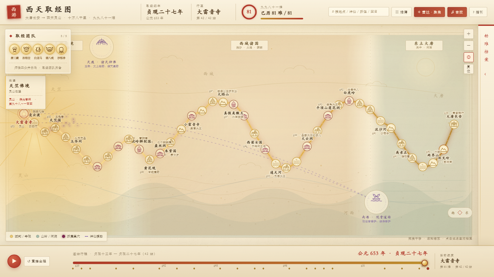

# 西游记 · 西天取经动态路线图

新中式国潮（唐）风格的《西游记》取经路线可视化单页：宣纸动态底纹、泥金发光路线、**42 处原著地点**、**九九八十一难逐条难簿**、**神仙谱系反向索引**、三大地理色区与随行程切换的地望气候、卷轴镜头、劫难回放、原著引文与国风音效。



更多预览：[火焰山 · 热浪](preview-fire.png) · [狮驼岭 · 妖氛](preview-dark.png) · [原著引文](preview-quote.png) · [劫难回放](preview-replay.png) · [八十一难难簿](preview-codex.png) · [神仙谱反查](preview-helper.png)

---

## 一、运行方式

**最简单**：双击 `index.html`，用 Chrome / Edge / Firefox 直接打开即可，无需安装、无需构建、无需联网。

**推荐**（避免个别浏览器对 `file://` 的限制）：在项目目录起一个静态服务：

```bash
cd xiyouji-route
python -m http.server 8000
# 浏览器打开 http://localhost:8000
```

所有资源均为本地文件，没有任何 CDN、字体外链或第三方库依赖。

**深链**：`index.html?node=11&card=1` 可直达第 11 站（白虎岭）并展开劫难档案，便于分享某一难。`node` 为 1–42 的站序，`card=1` 控制侧栏展开。

---

## 二、文件结构（数据与 UI 分离）

```
xiyouji-route/
├── index.html          页面骨架 + SVG 图标符号 / 渐变 / 滤镜；色区、氛围、粒子、引文、回放与各模态
├── css/style.css       全部视觉样式（宣纸、朱砂、泥金、妖气紫、气候染色、动画、响应式）
├── js/data.js          纯数据层：42 站 + 81 难难簿 + 3 大色区 + 5 段氛围 + 8 条引文 + 神仙谱与反向索引，零 DOM
├── js/app.js           逻辑层：路径生成、生长动画、时间轴、档案卡、检索、镜头、回放、粒子、音效、缩放平移
├── preview*.png        全图与各功能效果预览图
└── README.md
```

改内容只动 `js/data.js`；改样式只动 `css/style.css`；改交互只动 `js/app.js`。新增地点只需在 `WAYPOINTS` 追加一项并给出 `x / y / chapters`，路线曲线、节点图标、援助线、时间轴刻度与累计难数会自动派生。

> 坐标变换（`Y_STRETCH` 纵向舒展）属于渲染层，位于 `js/app.js`；数据层保存的是未经变换的原始坐标，且渲染层会先复制一份视图副本，不修改数据对象。

---

## 三、数据结构示例

`js/data.js` 暴露 `window.XIYOU_DATA`，其中 `WAYPOINTS` 为站点数组（以 JS 对象字面量承载，便于 `file://` 直接加载；如需纯 `.json` 可整段拷出）：

```json
{
  "id": "baihuling",
  "name": "白虎岭",
  "sub": "三打白骨精",
  "year": 642,
  "chapters": [27, 27],
  "chapter": "第二十七回 · 尸魔三戏唐三藏 圣僧恨逐美猴王",
  "type": "demon",
  "x": 1169, "y": 264,
  "demons": ["白骨夫人（尸魔）"],
  "helpers": [{ "name": "孙悟空（自行识破）", "side": "self" }],
  "joins": [],
  "aid": null,
  "landmark": true,
  "sound": "sword",
  "highlight": true,
  "story": "尸魔三变村姑、老妇、老翁来诓唐僧……"
}
```

| 字段 | 说明 |
| --- | --- |
| `type` | `capital` / `city` / `temple` / `mountain` / `water` / `cave` / `demon` / `destination`，决定 SVG Icon |
| `chapters` | `[起回, 止回]`，驱动「回目 → 地点」反向检索（输入 `59` 或「第五十九回」直达火焰山） |
| `demons` | 该地妖魔；非空时由 `#auraCanvas` 绘制暗紫 / 血红妖气粒子 |
| `helpers` | 降妖神仙 / 解厄者；`side` 为 `heaven` / `sea` / `buddha` / `self` / `court` |
| `aid` | `heaven` / `sea` / `null`，决定援助虚线从哪个天界锚点发出 |
| `joins` | 在此加入团队的成员 id |
| `landmark` | 缩略全图常驻显示地名；放大地图后显示全部地名 |
| `sound` | `bell` / `woodfish` / `sword` / `wind` / `drum` |

### 派生数据（自动计算，无需手写）

| 数据 | 来源 |
| --- | --- |
| `CALAMITIES`（81 条） | 第九十九回难簿逐条名录 + 每条归属站点 `at`；第 81 难「通天河落水」为观音补足 |
| `p.calamity` / `p.calamityList` | 由 `CALAMITIES` 按 `at` 折叠出的累计难数与本站难目，**不手写难数** |
| `HELPERS`（42 位） | 聚合各站 `helpers`，去括号注、拆「/／、」并列、按 `HELPER_ALIASES` 归一异称，记录 `places` 全部出手地点 |
| `INDEX.demons`（59 种）/ `INDEX.chapters`（12–100 回） | 妖魔与回目到站点的反向索引 |
| `p.era` / `p.index` / `p.helperNames` / `p.canonicalHelpers` / `p.isDemonLair` | 站点派生字段 |

`XIYOU_DATA.lookup(q)` 是纯数据检索（无 DOM），返回 `{ places, helpers, demons, chapters, calamities, chapterNo }` 五路命中，界面层只负责渲染。

### 叙事视觉数据（同样位于数据层，渲染层只按 id / 索引取用）

| 数据 | 结构 | 说明 |
| --- | --- | --- |
| `REGIONS` | `{ id, name, sub, x0, x1, tone, note }` | 三大地理色区，按长卷 x 坐标切分：东土大唐（青，1240–1600）／西域诸国（赭，430–1240）／天竺佛境（金，0–430）。属叙事构图分区，非真实测绘图幅 |
| `MOODS` | `{ id, from, to, tone, title, sub, verse }` | 5 段氛围，按**站点索引区间**判定：通天河冰面（17）、女儿国飞花（19–20）、火焰山热浪（22–23）、狮驼岭暗调（29–31）、灵山佛光（40–41） |
| `QUOTES` | `{ at, tag, source, text }` | 8 条重点劫难原著引文，`at` 为站点索引，附回目与语境出处 |
| `SCENES` | `{ set, cast:[…], lines:[{ w, t, a }] }` | 42 站每站一段「经典场景」剧场数据：`set` 决定背景剪影（capital/city/temple/mountain/river/cave/forest/palace/sky）；`cast` 为登场角色（取经团用 id，妖/神/凡用 `{ w, k, t }`，`t` 为袍色）；`lines` 为带动作 cues 的台词（`swing/warn/cast/laugh/fear/bow/descend/cry/boast/think/calm`）。渲染层自动并入 `WAYPOINTS[i].scene` |

配套纯函数：`regionAt(x)` / `moodAt(i)` / `quoteAt(i)`。所有色区、氛围与原著原句都写在 `js/data.js`，`js/app.js` 不硬编码任何原著内容。

---

## 四、功能对照

| 需求 | 实现 |
| --- | --- |
| 动态路线生长 | Catmull-Rom 平滑曲线 + `stroke-dashoffset` 逐帧推进；金色主线、朱砂辉光、流动光点、笔尖光晕四层叠加；开场约 7 秒自动巡游 42 站 |
| 时间轴 639–653 | 底部 **42 档逐站滑块**（年份仅作刻度）联动路线伸缩与高亮；播放 / 暂停 / 重播；21 个关键事件菱形刻度可点击跳转 |
| 节点悬停与点击 | Tooltip 显示地点、妖魔、解厄神仙、回目与累计难数；点击展开「劫难档案卡」（时地 / 妖魔 / 神仙 / 回目 / **本站历难** / 剧情 / 翻页）。**查阅档案不改变行程** |
| 全局检索 | 顶部搜索框支持地点名、妖怪、神仙、回目（`59`、`第五十九回`）、难名，输入即联想；按 `/` 聚焦，回车直达首条；搜「昴日星官」回车直达毒敌山琵琶洞 |
| 神仙谱系反查 | 搜索结果中的神仙条目、档案卡的神仙标签均可点开「神仙谱」面板，列出该神仙出手过的**全部**地点与回目，逐条可跳；如观世音菩萨 14 处、如来佛祖 4 处 |
| 八十一难难簿 | 顶部「难簿」按钮或点击八十一难环形进度打开；81 条依第九十九回原文逐条可点，已历朱砂标记，点击直达所属站点；档案卡「本站历难」chip 可反向定位难簿条目 |
| 妖魔谱 | 搜索结果中的妖魔条目可点开，列出该妖出现的所有地点 |
| 团队状态机 | 唐僧 → 悟空（两界山）→ 白龙马（鹰愁涧）→ 八戒（高老庄）→ 沙僧（流沙河）依次点亮；悟空在**白虎岭（贬书逐走）**与**真假美猴王（再贬心猿）**两度离队，头像转灰标「离」，下一站归队 |
| 神仙援助雷达 | 天庭 / 南海两个锚点，二次贝塞尔虚线连向 **32 处**需神佛出手之地；三态切换「聚焦 / 全览 / 关闭」，聚焦模式默认只亮焦点站 ±1 |
| 三大地理色区 | 长卷分东土大唐（青）／西域诸国（赭）／天竺佛境（金）三段晕染色带，配分界虚线、区名小匾与地貌暗纹；左侧「地望」匾额随当前站显示区域与气候 |
| 动态地望气候 | 通天河冰纹、女儿国飞花、火焰山热浪、狮驼岭妖雾暗调、灵山佛光，**随行程自动切换**（SVG 局部特效 + 页面级柔和染色），火焰山与狮驼岭不看文字即可分辨；遵循「减少动态效果」时降级为静态 |
| 卷轴镜头 | 播放 / 回放时视口随笔尖缓慢推近横移，结束自动平滑回到全景；右上角 ◎ 开关，手动拖拽 / 缩放会锁定视图，「复位」恢复跟随 |
| 劫难回放 | 档案卡「↺ 回放此劫」把选中站**前后三站**作慢镜复演：路线回卷重绘、档案卡与氛围逐站联动、中心站浮出引文；结束或按 Esc 自动回滚到开启前的行程 / 档案 / 侧栏状态 |
| 妖气粒子 | 妖穴不再用静态光晕，改由 Canvas 粒子层绘制暗紫 / 血红妖氛；只在已到达且靠近焦点的站点出现（最多 8 处），减少动效时改为静态点 |
| 原著引文 | 点选 8 处重点劫难时浮出卷轴式原句卡并注明回目出处；引文可由「❝ 原著引文」按钮重开、6.8 秒自动收起；行程一变即收起，避免与当前站不符 |
| 经典场景剧场 | 每站档案卡的「▶ 演此景」按钮打开一座小戏台：按 `set` 生成山/寺/河/洞/林/宫/城/天背景剪影，角色以纯 SVG 木偶登场（取经团、妖、神、凡各有造型），台词逐句以打字机呈现并弹出气泡，**说话者木偶高亮、举棒/施法/狂笑/惊恐/叩拜/自天而降/垂泪/得意/思忖/平宁等动作 cue 触发对应动画**；底部 ⏮ ▶ ⏭ ↺ 控制句进/播放暂停/句退/重播，圆点指示台词进度；支持键盘 ← → 切句、空格播放暂停、Esc 关闭；「减少动态效果」时自动降级为静态文字 |
| 音效反馈 | Web Audio 实时合成铃磬、木鱼、拔剑、风水、法鼓五种音色，无音频文件；右上角可静音 |
| 可折叠侧栏 | 桌面收起为浅色竖排卷轴标签；窄屏改为底部 48px 标题条 + 62vh 抽屉；Esc 收起；从宽屏切入窄屏时自动收起以免遮挡地图 |
| 地图操作 | 拖拽平移、滚轮 / 按钮缩放、复位；放大后显示全部地名；**窄屏默认局部视口并随行程跟随当前站**，手动平移 / 缩放后停止跟随，「复位」恢复 |
| 快捷键 | ← → 逐站、空格播放暂停、`/` 搜索、Esc 收起侧栏 / 引文 / 面板并退出回放；遵循系统「减少动态效果」 |

---

## 五、考据与技术说明

- **时间**：贞观十三年（639）自长安出发、贞观二十七年（653）抵灵山，15 个年份均有节点分布；纪年由 `eraOf()` 自动换算。
- **回目**：依百回本《西游记》第十二回至第一百回顺序排列，42 站覆盖 89 个回目。较上一版补齐黄风岭、四圣试禅心、真假美猴王、荆棘岭、七绝山、朱紫国、盘丝洞、黄花观、灭法国、隐雾山、凤仙郡、玉华州、金平府、铜台府、凌云渡 15 站。
- **难簿**：`CALAMITIES` 严格依第九十九回「灾难的簿子」原文（维基文库校本）录入 80 条，第 81 难为观音查簿后命揭谛追加的归途通天河落水（见同回正文）。前四难「金蝉遭贬、出胎几杀、满月抛江、寻亲报冤」为唐僧前尘，故起点长安显示「已历 4 难」，档案卡注明。第 6 难「折从落坑」一作「落坑折从」，此处从维基文库校本。
- **站点累计难数**不再是手写字段，而是由 `CALAMITIES[].at` 折叠派生，例如白虎岭 = 「贬退心猿二十难」= 20，火焰山 = 「收缚魔王四十九难」= 49，灵山 = 81，保证难簿与进度条永远一致。
- **神仙归一**：`观世音菩萨` 与 `观音菩萨`、`托塔李天王 / 哪吒三太子` 与 `李天王 / 哪吒` 等并列、异称写法统一合并，避免谱系里出现重复条目；「/」「／」「、」并列自动拆成多位神仙。
- **原著引文**：`QUOTES` 的 8 条原句均核对百回本原文（维基文库、识典古籍校本），出处为第十三回开篇诗 / 三藏答众僧 / 回末、第二十七回贬书、第四十七回咏通天河、第六十一回「有诗为证」火焰山诗、第七十四回太白金星报信、第九十九回观音查难簿。火焰山诗见于第六十一回回末正文（部分诗词选本径题第五十九回），此处从百回本正文。引文以简体转写，未改字句。
- **氛围与色区**：三段色区、五段气候是**叙事构图**而非地理测绘，目的是让「走到哪一段」有可感知的视觉节奏；特効层位于金线之下，页面级染色使用低不透明度 `multiply`，保证路线与地名始终清晰。
- **粒子与镜头坐标**：`#auraCanvas` 覆盖整个地图区，粒子位置由 `project()` 按 `preserveAspectRatio="meet"` 的缩放与留白换算，与 `zoomAt()` 共用同一套投影，因此缩放、平移后妖气仍贴合节点。镜头用逐帧插值推近 / 回弹，并设 1.9 秒限时强制对齐全景，避免低帧率下拖尾。
- **为何不用 ECharts / Three.js / Leaflet**：原著地理（十万八千里、西域诸国）并非可精确配准的现代坐标，套真实地图瓦片反而失真且需联网；这里改用纯 SVG 手绘「山水长卷」，把 42 站抽象为一条自右（东）向左（西）的卷轴路径，既贴合唐风审美，也保证零依赖、离线可运行、任意缩放不糊。若后续要接真实 GIS，只需替换 `drawWorld()` 与 `POINTS` 的 `x/y` 投影，其余逻辑无需改动。
- **音效**：浏览器要求音频上下文在用户手势中创建，因此首次交互后才会发声；不支持 Web Audio 的环境静默降级。

---

## 六、交互约定：进度与浏览分离

页面上存在两个互不干扰的状态，由 `js/app.js` 中的 `state.progress` 与 `state.browse` 分别维护：

| 状态 | 由谁改变 | 影响范围 |
| --- | --- | --- |
| **行程进度** `progress` | 时间轴滑块、播放 / 重播、键盘 ← →、事件菱形刻度、难簿 / 神仙谱跳转、搜索回车、深链 | 路线长度、年份、难数、团队状态、援助线焦点、窄屏视口跟随 |
| **档案浏览** `browse` | 点击地图节点、档案卡「上一站 / 下一站」 | 卡片内容、节点靛紫高亮、该站援助线 |

- 点击节点**只浏览**，行程不会倒退；卡片顶部出现「档案浏览 · 行程仍在 XXX」提示条与「回到当前行程」按钮。
- 浏览节点用**靛紫**描边，行程当前站仍是**朱砂**脉冲，两者同时可见。
- 主动拖动滑块或播放时，浏览态自动清除，档案卡重新跟随行程。
- `setProgress()` / `setBrowse()` / `jumpTo()` 是仅有的三个常规状态入口，新增交互时不要直接写 `state.progress`。
- **劫难回放是临时会话**：`state.replay` 记录 `saved.{progress, browse, drawn, sidebar}`，复演期间会临时改动行程与档案，但结束后（或用户拖滑块、播放、点节点、按 Esc 时）一律回滚。因此回放中看到的年份 / 难数变化不是真的进度回退。
- 镜头状态 `cameraActive / cameraReturning` 独立于上述两者，只影响 `viewBox`，不参与任何原著数据计算。

---

## 七、常见问题

- **打开后路线没画完？** 开场约 7 秒的自动巡游，点击地图、拖动滑块或按任意方向键即可打断；也可点「重播全程」。系统开启「减少动态效果」时不自动巡游。
- **点了地点，顶部年份没跟着变？** 这是刻意设计：查阅档案不改变行程，靛紫描边表示「正在浏览」。点卡片顶部「回到当前行程」或拖动时间轴即可归位。
- **起点就显示「已历 4 难」？** 难簿前四难记唐僧前尘（金蝉子贬世、江流儿身世），第九十九回于灵山追记，属原著设定。
- **援助线怎么只剩两三条？** 默认「聚焦」模式为降噪只显示焦点站 ±1；点右上角「雷达·聚焦」依次切到「全览」（32 条）与「关闭」。
- **怎么查某位神仙帮过哪些地方？** 顶部搜索框输入神仙名（如「太上老君」），点结果里的「神仙谱」条目；或直接点档案卡里的紫色神仙标签。
- **手机上地图只显示一段？** 窄屏默认显示当前站附近的局部长卷以便看清节点；左右拖动可浏览全程，点右上角「复位」恢复自动跟随当前站。
- **地图太小 / 想看全部地名？** 滚轮放大或点右上角「＋」，放大后隐藏的小地名会全部出现；「复位」回到全图。
- **镜头一直跟着笔尖，想看全景？** 点右上角 ◎ 关闭卷轴镜头；播放结束或暂停后本来就会自动回到全景，手动拖拽 / 缩放也会锁定视图，点「复位」可再次跟随。
- **引文卷轴怎么自己收起了？** 行程一变（拖滑块、播放、跳站）就会收起，避免引文与当前站不符；点档案卡里的「❝ 原著引文」可随时重开，或点 × 手动关闭。
- **回放会不会把我的进度弄乱？** 不会。回放前会保存行程、档案与侧栏状态，复演结束（或按 Esc、拖滑块、点节点）自动回滚；回放条上有「退出回放 ×」。
- **火焰山 / 狮驼岭的配色能改吗？** 氛围段与色区都在 `js/data.js` 的 `MOODS` / `REGIONS`，改 `from / to`、`tone` 或删掉某段即可；页面级染色与局部特效分别在 `css/style.css` 的 `.mood-wash` 与 `js/app.js` 的 `drawAtmosphere()`。系统开启「减少动态效果」时动画静止，但静态色区与染色仍保留。
- **妖气粒子会不会拖慢页面？** 粒子最多取 8 处已到达且靠近焦点的妖穴、每处 7 粒，全部在一张 Canvas 上绘制；缩放平移时按同一套 SVG 投影换算，不会生成额外 DOM 节点。
- **没有声音？** 确认右上角「音效」为高亮状态，且浏览器未静音标签页。
